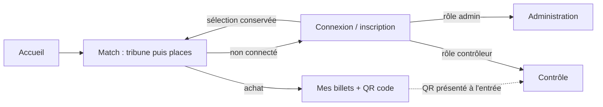

# Footix – Cahier des besoins

## 1. Contexte et objectifs
Un club de football amateur organise des matchs dans un stade de plusieurs tribunes. Il vend aujourd'hui ses places sur papier, sans suivi fiable : doublons, billets recopiés, aucun contrôle à l'entrée.
**Footix** est une API de billetterie qui permet de vendre des places numérotées en ligne, d'émettre des billets avec un QR code non falsifiable, et de contrôler chaque billet une seule fois à l'entrée du stade.

**Objectifs mesurables**
- Aucune place ne peut être vendue deux fois pour le même match, même avec des achats simultanés.
- Un billet ne peut être accepté qu'une seule fois à l'entrée.
- Un QR code fabriqué ou modifié est refusé.
- Les données personnelles et les mots de passe sont protégés.

## 2. Périmètre
**Dans le périmètre :** interface web (ordinateur et mobile), catalogue de matchs, plan de places par tribune, comptes utilisateurs, achat de 1 à 6 places, billets avec QR code, contrôle à l'entrée, administration des matchs, journaux d'audit et de scans.

**Hors périmètre (limites assumées) :** paiement bancaire réel (la commande est considérée comme payée), annulation et remboursement par le client, application mobile native, plan visuel du stade, envoi d'e-mails.

## 3. Acteurs
| Acteur | Rôle technique | Description |
|---|---|---|
| Visiteur | (aucun compte) | Consulte les matchs et la disponibilité |
| Spectateur | `spectator` | Achète des places, consulte ses billets |
| Contrôleur | `controller` | Scanne les billets à l'entrée |
| Administrateur | `admin` | Gère les matchs, consulte les journaux |

## 4. Besoins fonctionnels (user stories)
| N° | En tant que… | Je veux… | Afin de… |
|---|---|---|---|
| US1 | Visiteur | voir les matchs à venir | choisir un match |
| US2 | Visiteur | voir le prix et la disponibilité par tribune | choisir ma tribune |
| US3 | Visiteur | voir le plan des places d'une tribune | choisir mes places |
| US4 | Visiteur | créer un compte | pouvoir acheter |
| US5 | Visiteur | me connecter | accéder à mon espace |
| US6 | Spectateur | acheter 1 à 6 places | assister au match |
| US7 | Spectateur | voir mes commandes | suivre mes achats |
| US8 | Spectateur | voir mes billets et leur QR code | entrer au stade |
| US9 | Contrôleur | scanner un billet | autoriser l'entrée |
| US10 | Contrôleur | savoir si un billet est accepté, déjà utilisé ou invalide | agir à la porte |
| US11 | Administrateur | créer un match avec ses prix par tribune | ouvrir la vente |
| US12 | Administrateur | publier ou annuler un match | gérer la saison |
| US13 | Administrateur | consulter le journal d'audit | tracer les actions |
| US14 | Administrateur | consulter le journal des scans | analyser les entrées |

## 5. Règles de gestion
| N° | Règle | Où elle est garantie |
|---|---|---|
| RG1 | Un match ne se vend que s'il est « en vente » et pas commencé | `order.service` |
| RG2 | Une place doit exister, appartenir au stade du match et avoir un prix pour ce match | `order.repository.findSellableSeats` |
| RG3 | Une place ne se vend qu'une fois par match | **Base de données** : `UNIQUE (match_id, seat_id)` |
| RG4 | Une commande est « tout ou rien » | Transaction SQL (`withTransaction`) |
| RG5 | Maximum 6 places par commande | Validation Joi |
| RG6 | Le prix vient toujours de la base, jamais du client | `order.service` |
| RG7 | Un billet n'est utilisable qu'une fois | `UPDATE … WHERE status='valid'` (atomique) |
| RG8 | Un billet d'un match annulé est refusé | `ticket.service.scanTicket` |
| RG9 | Un match annulé est définitif ; transitions : brouillon → en vente → annulé | `match.service.TRANSITIONS` |
| RG10 | Toute inscription crée un spectateur | Validation + service + repository |
| RG11 | Mot de passe : 10 à 72 caractères, au moins une lettre et un chiffre | Validation Joi |
| RG12 | Un utilisateur ne voit que ses propres billets | Requête SQL avec `user_id` |
| RG13 | L'e-mail est unique sans tenir compte de la casse | Index `lower(email)` |

## 6. Exigences non fonctionnelles
- **Sécurité :** mots de passe hachés (bcrypt), authentification par jeton signé, contrôle d'accès par rôle, validation de toutes les entrées, requêtes SQL paramétrées, secrets dans l'environnement, limitation des tentatives de connexion, en-têtes HTTP sécurisés.
- **Fiabilité :** transactions, contraintes d'intégrité en base, sauvegarde et restauration testées.
- **Accessibilité (front) :** conformité RGAA / WCAG 2.1 niveau AA visée.
- **Éco-conception :** peu de dépendances, images légères, requêtes SQL ciblées.
- **Données personnelles :** minimisation (nom, e-mail), aucun mot de passe ni jeton dans les journaux.

## 7. Contraintes techniques
Node.js 22 / Express 4, PostgreSQL 16 (données métier), MongoDB (journaux), Docker Compose, Jest et Supertest pour les tests.
Interface : HTML, CSS et JavaScript sans framework, servie par le même serveur que l'API (même origine).

## 8. Écrans et enchaînement
| Écran | Adresse | User stories |
|---|---|---|
| Accueil : prochain match, plan du stade, matchs suivants | `/` | US1 |
| Match : plan du stade cliquable, grille de sièges, panier | `/match?id=…` | US2, US3, US6 |
| Connexion et inscription | `/connexion` | US4, US5 |
| Mes billets et QR codes | `/billets` | US7, US8 |
| Contrôle à l'entrée | `/controle` | US9, US10 |
| Administration : créer, publier, annuler, journal | `/admin` | US11 à US14 |

