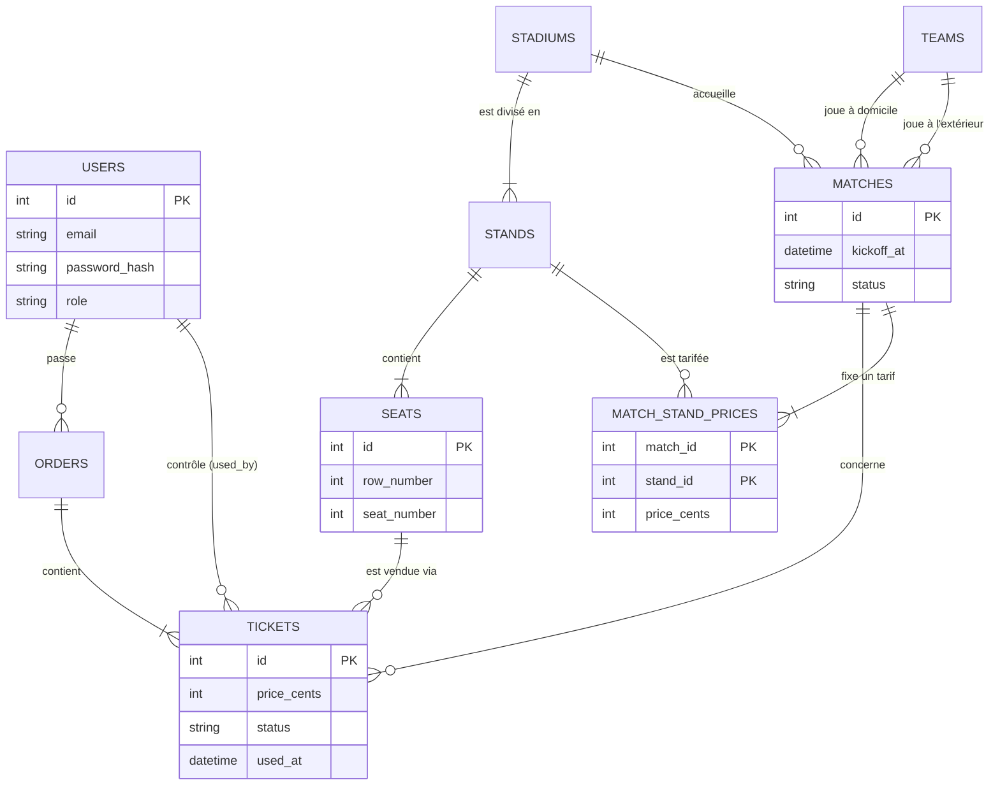

# Footix – Base de données

## 1. Choix des deux moteurs
| Besoin | Moteur | Pourquoi |
|---|---|---|
| Matchs, places, commandes, billets, utilisateurs | **PostgreSQL** (relationnel) | Relations fortes, contraintes d'intégrité, transactions ACID : indispensable pour ne jamais vendre deux fois la même place |
| Journal d'audit, journal des scans | **MongoDB** (NoSQL, documents) | Écriture massive, structure souple (`details`), aucune jointure, perte tolérable sans conséquence métier |

## 2. Schéma conceptuel (MCD)

`MATCH_STAND_PRICES` est une association « plusieurs à plusieurs » portant un attribut (le prix) : un match a un prix par tribune, une tribune a un prix différent à chaque match.

## 3. Schéma physique (MPD) – résumé
| Table | Clé primaire | Clés étrangères | Contraintes importantes |
|---|---|---|---|
| `users` | `id` | – | `role IN (spectator, controller, admin)` ; unicité sur `lower(email)` |
| `stadiums` | `id` | – | `UNIQUE (name, city)` |
| `stands` | `id` | `stadium_id` | `UNIQUE (stadium_id, name)` |
| `seats` | `id` | `stand_id` | `UNIQUE (stand_id, row_number, seat_number)`, valeurs > 0 |
| `teams` | `id` | – | `name UNIQUE` |
| `matches` | `id` | `stadium_id`, `home_team_id`, `away_team_id` | `home_team_id <> away_team_id` ; `status IN (draft, on_sale, cancelled)` |
| `match_stand_prices` | `(match_id, stand_id)` | `match_id`, `stand_id` | `price_cents >= 0` |
| `orders` | `id` | `user_id` | `total_cents >= 0` |
| `tickets` | `id` | `order_id`, `match_id`, `seat_id`, `used_by` | **`UNIQUE (match_id, seat_id)`** ; `status IN (valid, used)` |

Script complet : `db/01_schema.sql`.

## 4. Règles de nommage
Tables au pluriel, en minuscules avec `_` (`match_stand_prices`) ; colonnes en `snake_case` ; clés étrangères nommées `<table au singulier>_id` ; contraintes nommées explicitement quand le code les utilise (`tickets_match_seat_unique`) ; montants en **centimes** (entiers) pour éviter les erreurs d'arrondi des nombres décimaux.

## 5. Normalisation (3FN)
- Aucune donnée répétée : le nom du stade n'est pas copié dans chaque match, il est référencé.
- Le prix par tribune et par match a sa propre table : il ne dépend ni du match seul, ni de la tribune seule, mais des deux (clé composée).
- Seule redondance volontaire : `tickets.price_cents` conserve **le prix payé**. Si le tarif change plus tard, l'historique reste exact.

## 6. L'intégrité garantie par la base elle-même
La contrainte `tickets_match_seat_unique` est la protection centrale. Même si le code de l'application contenait un bug, ou si deux requêtes arrivaient exactement en même temps, PostgreSQL refuse la seconde insertion (erreur `23505`). Le code ne fait que traduire cette erreur en réponse `409 SEAT_ALREADY_SOLD`.

## 7. Utilisateurs de la base et droits (moindre privilège)
| Compte | Droits | Utilisé par |
|---|---|---|
| `footix_owner` / `footix` (propriétaire) | Tous (création et modification des tables) | Scripts d'installation, sauvegarde et restauration |
| `footix_app` | `SELECT, INSERT, UPDATE, DELETE` sur les tables ; **pas** de `CREATE`, `DROP`, `ALTER` | **L'API** |
| `footix_readonly` | `SELECT` uniquement ; **pas d'accès** à `users.password_hash` | Reporting |

Vérifié pour de vrai : le compte `footix_app` reçoit `must be owner of table tickets` quand il tente un `DROP TABLE`, et `footix_readonly` reçoit `permission denied for table users`. Script : `db/02_roles.sql`.

## 8. Sauvegarde et restauration (procédure testée)
```bash
DATABASE_URL=postgres://… ./scripts/backup.sh                  # crée backups/footix_<date>.dump
DATABASE_URL=postgres://… ./scripts/restore.sh backups/xxx.dump
```
Test réalisé : après sauvegarde, suppression des tables `tickets` et `orders` et des places, la restauration a retrouvé les 538 places et le ticket. En production : sauvegarde planifiée (cron), copie hors du serveur, et test de restauration régulier.

## 9. MongoDB
| Collection | Champs | Index |
|---|---|---|
| `auditlogs` | `action`, `actorId`, `actorRole`, `details` (document libre), `createdAt` | `action`, `createdAt` |
| `scanlogs` | `ticketId`, `matchId`, `controllerId`, `result` (accepted, already_used, invalid_signature, unknown_ticket, match_cancelled), `createdAt` | `matchId`, `createdAt` |

Règle : une panne de MongoDB ne bloque jamais une vente (les fonctions de journalisation avalent leurs erreurs). Aucun mot de passe ni jeton n'est écrit dans ces journaux (vérifié par un test).
